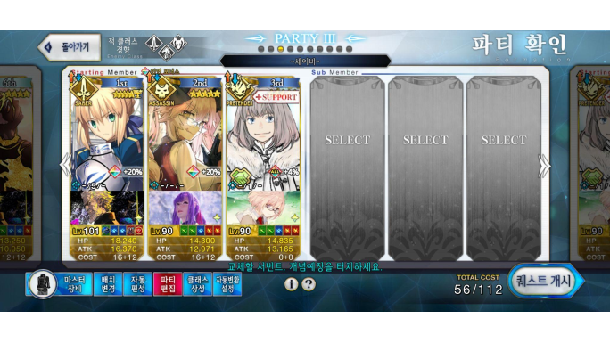
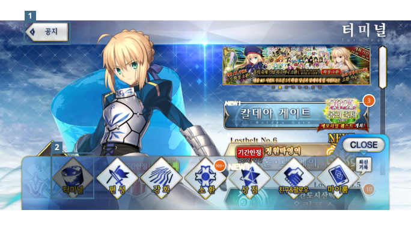

# Fate/Grand Order 전투와 UI 사용성 분석

2025년 3월 13일 경쟁작 리뷰에서 편성과 전투 선택, 반복 플레이를 살폈습니다. 공지 버튼과 터미널 이동 버튼의 사용성도 분석했습니다.

## 편성과 전투 선택

적의 클래스와 편성 코스트를 고려해 서번트와 개념예장을 구성합니다. 전투에서는 배분된 카드, 스킬 사용 시점과 NP 수급을 보고 보구 사용 순서를 판단합니다.

보스전에서는 적의 패턴에 대응하는 선택이 재미를 만듭니다. 재료 수급을 위한 반복 전투에서는 정해진 공략과 비슷한 조작을 여러 차례 수행하게 됩니다.

## 공지와 돌아가기 기능 식별

[1]은 공지 버튼, [2]는 터미널 이동 버튼입니다.

터미널 왼쪽 위의 공지 버튼은 공지사항 UI를 엽니다. 다른 화면에서는 같은 위치의 화살표 버튼이 돌아가기 기능을 수행하므로 기능을 혼동할 수 있습니다.

## 터미널 이동 버튼

기존에는 돌아가기 버튼으로 터미널에 이동했습니다. 하단에 터미널 버튼을 추가한 화면에서는 기존 이용자가 편성 버튼과 위치를 혼동하거나 신규 이용자가 사용 빈도가 낮은 버튼으로 인식할 가능성을 살폈습니다.

[포트폴리오 PDF 16–17쪽](../portfolio/김해준_게임QA_포트폴리오.pdf) · [포트폴리오 홈](../README.md)
