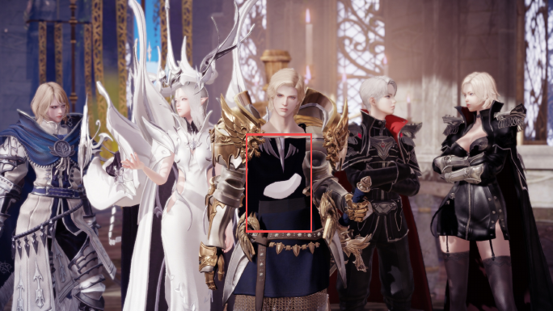
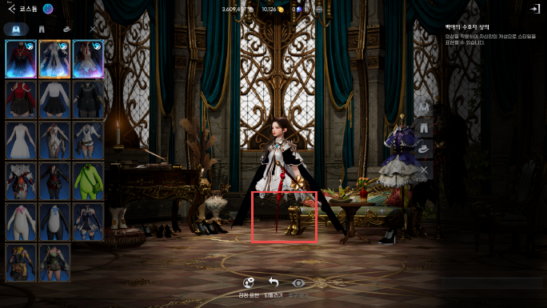

# 로스트아크 개발사 버그 제보

## PC NPC 외형 오류

여왕의 방 연출에서 실리안의 몸통 일부가 표시되지 않는 현상을 발견했습니다. 2026년 4월 27일 게임 화면을 첨부해 고객센터에 제보했습니다.

빨간 사각형은 몸통 일부가 표시되지 않은 영역입니다.

4월 29일 고객센터는 정기점검으로 일부 연출의 NPC 외형 문제를 수정했다고 답했습니다. 같은 날 [공식 업데이트 공지](https://lostark.game.onstove.com/News/Notice/Views/13423)에서도 관련 NPC 외형 수정 항목을 확인했습니다. 맡은 작업은 오류 발견, 화면 첨부 제보와 수정 안내 확인입니다.

## 모바일 CBT 코스튬 외형 오류

2025년 11월 CBT 플레이 중 코스튬 미리보기에서 캐릭터 하체 일부가 표시되지 않는 현상을 발견해 개발사에 제보했습니다.

빨간 사각형은 하체 일부가 표시되지 않은 영역입니다.

## 모바일 CBT 임무 이동 안내

불타는 레온하트 임무의 술집 구간에서 금색 이동 안내가 아래쪽 문 대신 벽을 가리키는 현상을 발견했습니다. 예상 출구와 안내 위치가 다른 문제로 개발사에 제보했습니다.

[포트폴리오 PDF 12–13쪽](../portfolio/김해준_게임QA_포트폴리오.pdf) · [포트폴리오 홈](../README.md)
