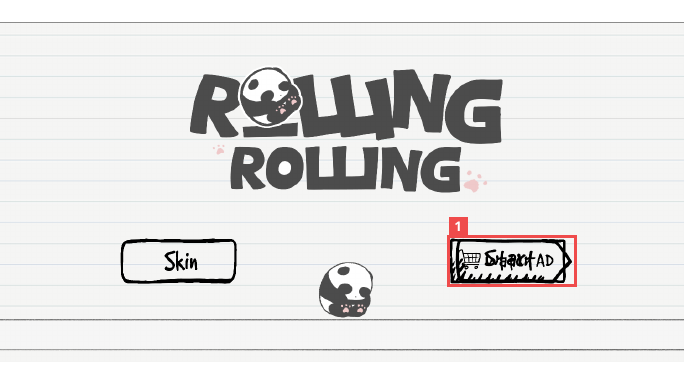

# RollingRolling 스킨 UI 오류 조사와 수정

2025년 3월부터 6월까지 참여한 5인 팀의 Unity 모바일 캐주얼 게임입니다. QA 및 서브 아트를 맡았으며, 창업 동아리 시제품 전시와 Google Play 출시에 참여했습니다.

## 시작 화면의 버튼 겹침



빨간 사각형 안에서 WatchAD와 플레이 버튼의 그림과 문구가 같은 위치에 겹쳐 있습니다.

스킨 선택 화면에서는 기본·해금된 스킨의 시작 가능 여부, 잠긴 스킨의 광고 안내, 광고 보상 이후 버튼 전환을 확인했습니다.

## 스킨 UI 상태 갱신

1.0.13에서 UI 연결과 스킨 상태 갱신 코드를 수정했습니다.

- SkinSceneInitializer에서 연결한 버튼을 SkinManager에 전달
- SkinManager에 LinkUIElements와 외부 갱신 함수 RefreshSkinUIState 추가
- 광고 보상 이후 RefreshSkinUIState 호출
- 스킨 잠금 상태를 초기화하는 에디터 디버그 메뉴 추가

```csharp
SkinManager.Instance.LinkUIElements(startButton, watchAdButton);

public void RefreshSkinUIState()
{
    ApplySkin();
}
```

위 코드는 후속 소스에 남아 있는 연결·갱신 부분입니다. 1.0.13 수정 내용은 당시 변경 기록과 1.0.12·1.0.14 소스 비교로 확인했습니다. 시작 화면의 버튼 겹침에 대한 수정 후 재검증 기록은 없습니다.

## 광고 UI 피드백 대응

1.0.15에서는 팀의 광고 UI 피드백에 따라 배너 크기와 광고 종료 후 Android 화면 처리를 조사·변경했습니다. 표준 배너 적용과 보상형 광고 종료 후 화면 UI 처리 변경에 참여했습니다.

[포트폴리오 PDF 10쪽](../portfolio/김해준_게임QA_포트폴리오.pdf) · [포트폴리오 홈](../README.md)
