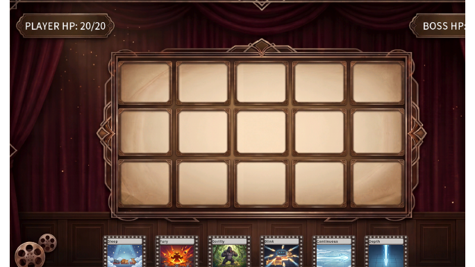
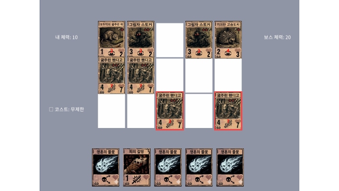

# 로즈마리 카드 효과 테스트와 결함 리포트

4인 팀의 카드게임·덱빌드 프로토타입에서 QA를 맡고 기획·UI 작업에 참여했습니다. 2026년 8월까지 개발본을 확인하며 카드 효과, 마법·소환수 배치, 덱 저장과 대화창을 테스트했습니다.

## 테스트 케이스

| ID | 조건과 절차 | 기대 결과 | 기록 결과 |
| --- | --- | --- | --- |
| TC-GRD-005 | 마법 카드가 포함된 덱으로 플레이하며 행·열 효과와 적 피해 확인 | 효과가 정해진 대로 적용되고 마법 카드는 그리드에 배치되지 않음 | FAIL. 빠르게 사용하면 빈 칸에 마법 카드가 배치됨 |
| TC-DEK-003 | 확인할 카드를 저장한 덱으로 플레이하며 턴 진행 | 저장한 카드가 모두 플레이어 덱에 포함됨 | PASS |

## 카드 효과 연계 결함

BUG-2026-004 · 2026.07.14 · PC · 기록 상태 Open

‘피의 갈망’의 추가 피해 효과가 ‘영혼의 불꽃’과 연계되는지 확인했습니다. 체력 7인 ‘굶주린 웬디고’를 공격한 뒤 남은 체력을 비교했습니다.

1. 두 카드가 포함된 덱으로 플레이합니다.
2. 피의 갈망을 적용한 뒤 영혼의 불꽃으로 웬디고를 공격합니다.
3. 공격 전후 체력과 카드 설명의 피해량을 비교합니다.

| 비교 항목 | 기대 결과 | 실제 결과 |
| --- | --- | --- |
| 피해량 | 기본 4 + 추가 2 = 6 | 공격 전 체력 7 − 남은 체력 3 = 4 |
| 남은 체력 | 1 | 3 |

빨간 사각형은 체력을 비교한 웬디고를 표시합니다.

## 기록과 팀 전달

기대 결과와 실제 동작을 비교해 Excel TC와 PowerPoint 리포트를 작성했습니다. Google Drive QA 폴더를 갱신하고 Discord로 피드백과 변경 사항을 전달했습니다. 이 결함의 기록 상태는 Open입니다.

[포트폴리오 PDF 6–8쪽](../portfolio/김해준_게임QA_포트폴리오.pdf) · [포트폴리오 홈](../README.md)
